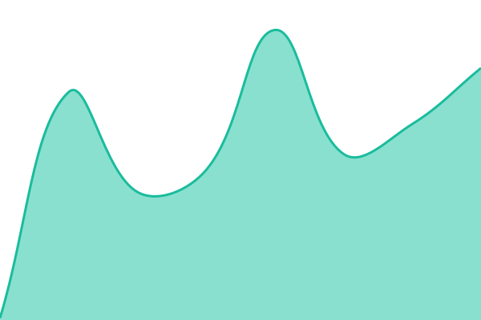
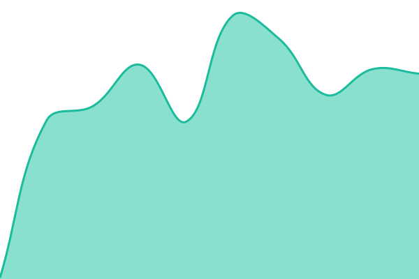
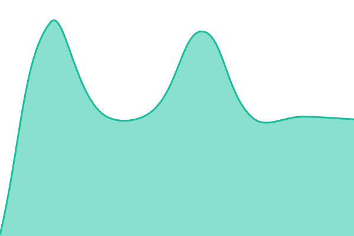
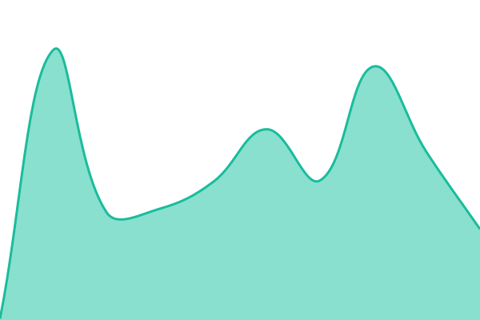

# Estado de los servicios de NueveOnce

Este repositorio publica la página de estado de NueveOnce: la disponibilidad de nuestras plataformas, los incidentes y los mantenimientos programados. Las verificaciones se hacen automáticamente cada pocos minutos.

**Página de estado:** [status.nueveonce.com](https://status.nueveonce.com/)

**Estado actual:** <!--live status--> **🟧 Interrupción parcial**

## ¿Tienes un problema?

Si alguno de nuestros servicios no funciona como esperas, contacta a [nuestro equipo de soporte](https://www.nueveonce.com/contacto). Este repositorio no recibe reportes.

## Servicios

<!--start: status pages-->
<!-- This summary is generated by Upptime (https://github.com/upptime/upptime) -->
<!-- Do not edit this manually, your changes will be overwritten -->
<!-- prettier-ignore -->
| URL | Estado | Historial | Tiempo de respuesta | Disponibilidad |
| --- | ------ | ------- | ------------- | ------ |
|  [API SIGNO](https://api.signo.nueveonce.com/api/health/ready) | 🟩 Operativo | [api-signo.yml](https://github.com/Grupo-Nuevo-Once/nueveonce-status/commits/HEAD/history/api-signo.yml) | 

 300 ms
     
 | 

<a href="https://status.nueveonce.com/history/api-signo">100.00%</a>
    

|  [Dashboard SIGNO](https://signo.nueveonce.com/) | 🟩 Operativo | [dashboard-signo.yml](https://github.com/Grupo-Nuevo-Once/nueveonce-status/commits/HEAD/history/dashboard-signo.yml) | 

 109 ms
     
 | 

<a href="https://status.nueveonce.com/history/dashboard-signo">100.00%</a>
    

|  [API de integraciones](https://integrations.nueveonce.com/integrations/v1/health) | 🟩 Operativo | [api-integraciones.yml](https://github.com/Grupo-Nuevo-Once/nueveonce-status/commits/HEAD/history/api-integraciones.yml) | 

 180 ms
     
 | 

<a href="https://status.nueveonce.com/history/api-integraciones">100.00%</a>
    

|  [Portal de desarrolladores](https://developers.nueveonce.com/) | 🟩 Operativo | [portal-desarrolladores.yml](https://github.com/Grupo-Nuevo-Once/nueveonce-status/commits/HEAD/history/portal-desarrolladores.yml) | 

 105 ms
     
 | 

<a href="https://status.nueveonce.com/history/portal-desarrolladores">100.00%</a>
    

|  [Telemedicina (web)](https://telemedicine.nueveonce.com/) | 🟩 Operativo | [telemedicina-web.yml](https://github.com/Grupo-Nuevo-Once/nueveonce-status/commits/HEAD/history/telemedicina-web.yml) | 

 109 ms
     
 | 

<a href="https://status.nueveonce.com/history/telemedicina-web">100.00%</a>
    

|  [Aquí Contigo (web)](https://aquicontigo.nueveonce.com/) | 🟩 Operativo | [aqui-contigo-web.yml](https://github.com/Grupo-Nuevo-Once/nueveonce-status/commits/HEAD/history/aqui-contigo-web.yml) | 

 88 ms
     
 | 

<a href="https://status.nueveonce.com/history/aqui-contigo-web">100.00%</a>
    

|  [App web de pacientes](https://app.nueveonce.com/) | 🟥 Con incidencias | [app-pacientes-web.yml](https://github.com/Grupo-Nuevo-Once/nueveonce-status/commits/HEAD/history/app-pacientes-web.yml) | 

 132 ms
     
 | 

<a href="https://status.nueveonce.com/history/app-pacientes-web">85.84%</a>
    

|  [Encuestas](https://encuestas.nueveonce.com/) | 🟩 Operativo | [encuestas.yml](https://github.com/Grupo-Nuevo-Once/nueveonce-status/commits/HEAD/history/encuestas.yml) | 

 152 ms
     
 | 

<a href="https://status.nueveonce.com/history/encuestas">100.00%</a>
    

<!--end: status pages-->

La página funciona con [Upptime](https://upptime.js.org), un proyecto de código abierto.
